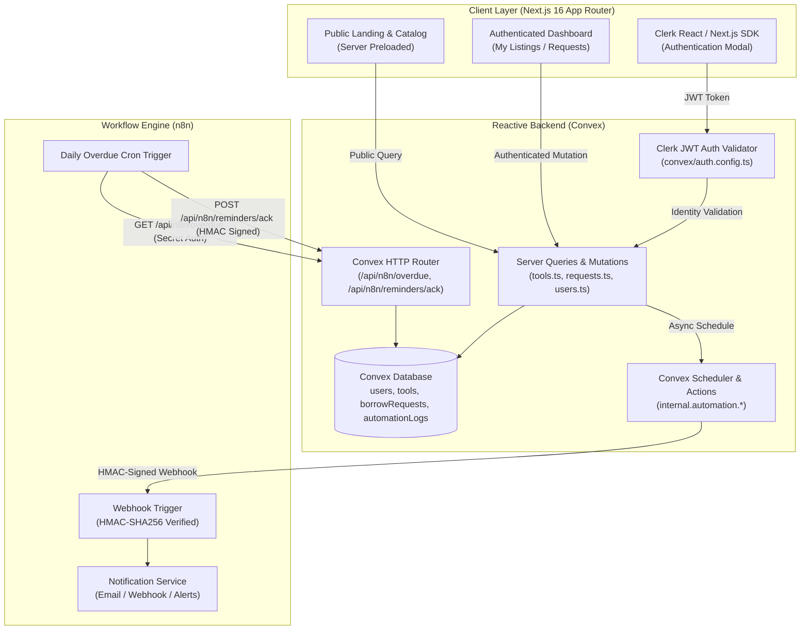
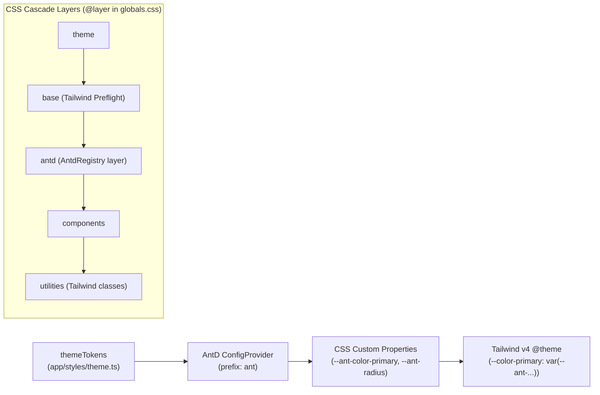

# 🔄 LendLoop

<div align="center">

**"Borrow what you need. Lend what you don’t."**

*A modern, privacy-first neighborhood tool-sharing platform powered by Next.js 16, Convex, Clerk, and n8n.*

[](https://nextjs.org/)
[](https://react.dev/)
[](https://convex.dev/)
[](https://clerk.com/)
[](https://ant.design/)
[](https://tailwindcss.com/)
[](https://n8n.io/)

</div>

---

## 📖 Table of Contents

- [Overview](#-overview)
- [Key Features](#-key-features)
- [Architecture & Tech Stack](#-architecture--tech-stack)
- [Design System: Ant Design v6 + Tailwind CSS v4](#-design-system-ant-design-v6--tailwind-css-v4)
- [Data Model & Security](#-data-model--security)
- [Bidirectional n8n Automation Bridge](#-bidirectional-n8n-automation-bridge)
- [Directory Structure](#-directory-structure)
- [Environment Variables](#-environment-variables)
- [Getting Started](#-getting-started)
- [Development Workflows](#-development-workflows)
- [Security & Data Minimization](#-security--data-minimization)
- [License](#-license)

---

## 🌟 Overview

Neighborhood communities frequently buy expensive, rarely used tools—such as power drills, lawn mowers, pressure washers, and camping equipment—individually. This leads to redundant household expenses and cluttered garages.

**LendLoop** solves this by establishing a trusted, local peer-to-peer lending ecosystem where neighbors can safely lend and borrow equipment. Built with a privacy-first architecture, LendLoop features strict server-enforced role-based access controls, real-time reactive data updates, and automated notifications and overdue reminders orchestrated via n8n.

---

## ✨ Key Features

### 🛡️ Privacy-Preserving Public Catalog
- **Data Minimization by Default:** Unauthenticated visitors can freely browse available neighborhood tools without exposing sensitive neighbor information.
- **Owner Anonymity:** Public queries strip owner identities, contact info, email addresses, and timestamps at the database query layer.
- **Server Preloading:** Uses Next.js App Router and Convex `preloadQuery` for instant first paint, complete SEO indexability, and zero layout shift or loading spinner flash.

### 🔐 Server-Enforced Role-Based Access Control (RBAC)
- **Standard Users (`user`)**:
  - List new tools with categories (`power tools`, `garden`, `kitchen`, `camping`, `hand tools`, `other`) and condition ratings (`new`, `like-new`, `good`, `fair`).
  - Edit and delete their own listings.
  - Submit date-ranged borrow requests with built-in validation (prohibits self-borrowing and inverted date ranges).
  - Approve or decline incoming requests for their tools.
  - Mark active loans as returned.
- **Administrators (`admin`)**:
  - Moderate listings across the platform.
  - Access neighborhood-wide loan oversight.
  - Award or revoke community **"Trusted Lender"** badges.
- **Tamper-Proof Authorization:** All authorization checks run inside Convex server functions (`requireUser`, `requireAdmin`, `canManageTool`, `canReturnLoan`), completely immune to client-side UI tampering.

### 🔄 End-to-End Borrowing Lifecycle
- **Status State Machine:** Seamless state flow across `pending` ➔ `approved` ➔ `loaned` ➔ `returned` (with support for `declined` and `cancelled`).
- **Conflict Prevention:** Approving a borrow request automatically transitions tool availability to `loaned` and marks conflicting requests as declined.
- **Return Handshake:** Both lender and borrower have permission to confirm the physical return of equipment, immediately restoring tool availability to `available`.

### ⚡ Bidirectional Workflow Automation (n8n)
- **Outbound Webhooks:** Convex dispatches data-minimized, HMAC-SHA256 signed webhooks to n8n upon request creation or status updates to notify participants via email or chat.
- **Inbound Overdue Engine:** Scheduled n8n workflows poll an authenticated Convex HTTP endpoint (`GET /api/n8n/overdue`) to identify overdue loans.
- **Idempotent Acknowledgment:** n8n reports reminder delivery via `POST /api/n8n/reminders/ack` using idempotency keys, preventing duplicate reminders upon workflow retries.
- **Activity Feed:** Automation events (e.g., *"Reminder sent 2 days ago"*) are logged into `automationLogs` and rendered directly on loan cards.

### 🎨 Community Design System
- Built on **Ant Design v6** integrated with `@ant-design/nextjs-registry` for zero-FOUC server rendering.
- Custom community color palette featuring warm emerald (`#059669`), soft slates, dark nav surface (`#001529`), and responsive Tailwind CSS v4 layout utilities.
- Reusable Atomic Component hierarchy (`atoms`, `molecules`, `compound`).

---

## 🏗️ Architecture & Tech Stack



| Layer | Technology | Details |
| :--- | :--- | :--- |
| **Framework** | Next.js 16.4 (App Router) | React 19, TypeScript 5, Turbopack |
| **Backend & DB** | Convex 1.49 | Reactive document database, ACID mutations, scheduler, HTTP actions |
| **Authentication** | Clerk (`@clerk/nextjs`) | Passkeys, OAuth, Clerk JWT integration with Convex |
| **Component Library** | Ant Design v6 (`antd`) | `@ant-design/nextjs-registry`, `@ant-design/icons`, `@ant-design/cssinjs` |
| **Styling** | Tailwind CSS v4 + AntD Theme | Custom tokens, warm emerald aesthetic, Geist font |
| **Workflow Engine** | n8n | Self-hosted or cloud-hosted automation for webhooks & cron reminders |
| **Utilities** | `date-fns` v4, Web Crypto API | Date calculations, constant-time HMAC-SHA256 signature verification |

---

## 🎨 Design System: Ant Design v6 + Tailwind CSS v4

LendLoop implements a custom design system that unites **Ant Design (v6)** and **Tailwind CSS (v4)** into a seamless, conflict-free UI architecture. 

Combining an enterprise component library with utility-first CSS in Next.js App Router typically leads to four major hurdles:
1. **Specificity Wars:** Ant Design's CSS-in-JS styles can override Tailwind utility classes, requiring brittle `!important` flags.
2. **CSS Reset Clashes:** Tailwind Preflight and Ant Design resets can fight over global HTML element baselines.
3. **Dual-Token Drift:** Defining design tokens (colors, border radii) separately in both Tailwind and Ant Design leads to maintenance nightmares.
4. **SSR Flash of Unstyled Content (FOUC):** Dynamic runtime CSS injection can flash unstyled markup before hydration in React 19 / Next.js App Router.

Here is how LendLoop solves all four:



### 1. Cascade Layer Ordering (`@layer`)
In [`app/globals.css`](file:///d:/Coding/Repos/Work/lend-loop-nextjs/app/globals.css), we declare explicit CSS cascade layers:

```css
@layer theme, base, antd, components, utilities;

/* Tailwind CSS v4 imports scoped to layers */
@import 'tailwindcss/theme.css' layer(theme);
@import 'tailwindcss/preflight.css' layer(base);
@import 'tailwindcss/utilities.css' layer(utilities);
```

In [`app/components/compound/AllProviders/AllProvider.tsx`](file:///d:/Coding/Repos/Work/lend-loop-nextjs/app/components/compound/AllProviders/AllProvider.tsx), the `<AntdRegistry>` is given the `layer` prop:

```tsx
<AntdRegistry layer>
  <ThemeProvider>
    <App className="min-h-full flex flex-col flex-1">
      {children}
    </App>
  </ThemeProvider>
</AntdRegistry>
```

> [!TIP]
> **Why this matters:** By emitting Ant Design styles inside `@layer antd` and Tailwind utilities inside `@layer utilities`, the browser evaluates utility classes *after* component styles. Any Tailwind utility (`mt-4`, `p-6`, `flex`, `hidden`, `text-center`) applied to an Ant Design component automatically wins specificity **without requiring `!important`**.

---

### 2. Single Source of Truth via CSS Variables
Rather than duplicating color palettes across configuration files, design tokens originate in [`app/styles/theme.ts`](file:///d:/Coding/Repos/Work/lend-loop-nextjs/app/styles/theme.ts):

```typescript
export const themeTokens = {
  colorPrimary: '#059669',        // Warm Emerald
  colorPrimaryHover: '#10b981',
  colorBgLayout: '#f8fafc',       // Slate 50
  colorTextBase: '#1f2937',       // Slate 800
  borderRadius: 8,
  borderRadiusLG: 12,
  headerBg: '#001529',
  headerBorder: '#1e293b',
};

export const defaultThemeConfig: ThemeConfig = {
  cssVar: { prefix: 'ant', key: 'app' },
  hashed: false,
  token: themeTokens,
  components: {
    Button: { borderRadius: themeTokens.borderRadius, controlHeight: 38 },
    Card: { borderRadiusLG: themeTokens.borderRadiusLG },
    // ...
  },
};
```

Ant Design exposes these tokens directly as unhashed CSS variables (`--ant-color-primary`, `--ant-border-radius`, etc.). 

In [`app/globals.css`](file:///d:/Coding/Repos/Work/lend-loop-nextjs/app/globals.css), Tailwind CSS v4's `@theme` maps directly to those variables:

```css
@theme {
  --color-primary: var(--ant-color-primary);
  --color-primary-hover: var(--ant-color-primary-hover);
  --color-brand: var(--ant-color-primary);
  --color-text-main: var(--ant-color-text);
  --color-text-heading: var(--ant-color-text-heading);
  --color-bg-layout: var(--ant-color-bg-layout);
  --color-header-bg: var(--ant-header-bg);
  --color-header-border: var(--ant-header-border);
  --radius-base: var(--ant-border-radius);
  --radius-lg: var(--ant-border-radius-lg);
}
```

Updating a color or radius in `theme.ts` instantly cascades across both Ant Design components and all Tailwind utility classes (`bg-primary`, `bg-bg-layout`, `rounded-radius-base`, `text-text-main`) with zero token drift.

---

### 3. Server-Side Rendering & Zero-FOUC Pipeline
To eliminate visual flashing during SSR:
- `@ant-design/nextjs-registry` extracts and inlines critical CSS on the server during Next.js App Router rendering.
- The `<App>` wrapper provides unified context for static methods (`message`, `modal`, `notification`) that inherit the theme.
- Client hydration seamlessly adopts the server-rendered styles with zero layout shift.

---

### 4. Atomic Component Hierarchy
LendLoop organizes UI elements using Atomic Design principles under `app/components/`:

```text
app/components/
├── atoms/          # Primitive wrappers (Button, Input, Select, Switch, Tag, Badge, Typography, etc.)
├── molecules/      # Composed controls (Card, DatePicker / RangePicker, Modal, Popconfirm, Empty, Flex)
├── compound/       # Orchestrator layouts (Navbar, AllProviders)
└── index.ts        # Unified barrel export
```

#### Clean Barrel Usage:
Components are imported directly from `@/app/components`, passing standard Ant Design props while seamlessly accepting Tailwind utility classes:

```tsx
import { Button, Card, Flex, Tag, Title, Text } from '@/app/components';

export const ToolCard = ({ tool }) => (
  <Card 
    hoverable 
    className="h-full border border-border-default hover:border-brand transition-all shadow-sm"
  >
    <Flex vertical gap="middle">
      <Flex justify="space-between" align="center">
        <Title level={4} className="mb-0 text-text-heading">{tool.name}</Title>
        <Tag color="success">{tool.condition}</Tag>
      </Flex>
      <Text className="text-text-muted text-sm">{tool.description}</Text>
      <Button type="primary" className="w-full mt-2">
        Request Borrow
      </Button>
    </Flex>
  </Card>
);
```

---

## 🗄️ Data Model & Security

Convex enforces end-to-end type safety and indexed queries across four primary tables:

```typescript
// convex/schema.ts

users: {
  tokenIdentifier: string;        // Clerk unique token (indexed)
  name: string;
  email: string;
  role: "user" | "admin";         // Strict RBAC role (indexed)
  isTrustedLender: boolean;       // Community trust badge
  createdAt: number;
}

tools: {
  ownerId: Id<"users">;           // Foreign key to users (indexed)
  name: string;
  category: "power tools" | "garden" | "kitchen" | "camping" | "hand tools" | "other"; // (indexed)
  condition: "new" | "like-new" | "good" | "fair";
  description: string;
  status: "available" | "loaned" | "maintenance"; // (indexed)
  createdAt: number;
}

borrowRequests: {
  toolId: Id<"tools">;            // Foreign key to tools (indexed)
  borrowerId: Id<"users">;        // Requester (indexed)
  lenderId: Id<"users">;          // Tool owner (indexed)
  startDate: string;              // ISO YYYY-MM-DD
  endDate: string;                // ISO YYYY-MM-DD
  status: "pending" | "approved" | "declined" | "returned" | "cancelled"; // (indexed)
  createdAt: number;
  updatedAt: number;
  lastReminderSentAt?: number;
}

automationLogs: {
  loanId?: Id<"borrowRequests">;  // Associated loan (indexed)
  actionType: "request_notification" | "overdue_reminder" | "status_sync";
  status: "success" | "failed";
  idempotencyKey: string;         // Deduplication key (indexed)
  summary: string;
  timestamp: number;
}
```

---

## 🔌 Bidirectional n8n Automation Bridge

LendLoop integrates with n8n via a cryptographically secured bidirectional bridge:

### 1. Outbound Notifications (Convex ➔ n8n)
When a borrow request is created or changes status:
- Convex schedules `internal.automation.notifyStatusChange`.
- A minimal payload is assembled (omitting internal credentials and personal profile attributes).
- An **HMAC-SHA256** hex digest is computed using `N8N_WEBHOOK_SECRET`.
- Dispatched to `N8N_WEBHOOK_URL` with headers:
  - `X-LendLoop-Signature`: Hex-encoded HMAC-SHA256 hash.
  - `X-LendLoop-Timestamp`: Unix timestamp (requests outside a 300-second window are rejected to prevent replay attacks).

### 2. Inbound Overdue Reminders (n8n ➔ Convex)
1. **Poll Overdue Loans**:
   - `GET /api/n8n/overdue`
   - Requires `Authorization: Bearer <N8N_CONVEX_SYNC_SECRET>` or `x-n8n-secret` header.
   - Returns all active loans whose return date has passed.
2. **Acknowledge Delivery**:
   - `POST /api/n8n/reminders/ack`
   - Payload: `{ loanId, idempotencyKey, channel, reminderDate }`
   - Signed via HMAC-SHA256 header.
   - Verified via constant-time XOR comparison to defend against timing attacks.
   - Duplicate submissions with the same `idempotencyKey` are acknowledged with HTTP 200 without creating redundant logs or updating timestamps.

---

## 📁 Directory Structure

```text
lend-loop-nextjs/
├── app/                                 # Next.js App Router root
│   ├── (landing)/                       # Public landing page route group
│   │   ├── components/                  # Hero, PublicCatalog, HowItWorks, Community CTA
│   │   └── page.tsx                     # Server-preloaded public catalog page
│   ├── components/                      # Design System Atomic Architecture
│   │   ├── atoms/                       # Button, Input, Tag, Badge, Avatar, Spin, etc.
│   │   ├── molecules/                   # Card, DatePicker, Modal, Popconfirm, Empty, etc.
│   │   └── compound/                    # Navbar, AllProviders
│   ├── styles/                          # Theme tokens and Ant Design ConfigProvider
│   ├── globals.css                      # Tailwind CSS v4 directives & custom tokens
│   └── layout.tsx                       # Root HTML layout with providers and Navbar
├── convex/                              # Convex reactive backend
│   ├── _generated/                      # Auto-generated Convex types and API
│   ├── lib/                             # Core library helpers
│   │   ├── auth.ts                      # Server-side RBAC utilities (requireUser, requireAdmin)
│   │   └── crypto.ts                    # Web Crypto HMAC-SHA256 sign & verify
│   ├── auth.config.ts                   # Clerk JWT issuer provider configuration
│   ├── automation.ts                    # Internal actions & automation log mutations
│   ├── http.ts                          # HTTP router (/api/n8n/overdue, /api/n8n/reminders/ack)
│   ├── requests.ts                      # Borrowing lifecycle queries & mutations
│   ├── schema.ts                        # Database schema definition
│   ├── tools.ts                         # Tool catalog queries, filters, and moderation
│   └── users.ts                         # User profile synchronization and management
├── openspec/                            # OpenSpec specifications and change proposals
│   └── changes/lendloop-tool-lending/   # Proposals, designs, specs, and task tracking
├── public/                              # Static public assets
├── .env.example                         # Environment configuration template
├── package.json                         # Dependencies and npm scripts
├── tsconfig.json                        # TypeScript configuration
└── yarn.lock                            # Deterministic package dependency lockfile
```

---

## ⚙️ Environment Variables

Copy the provided `.env.example` template to `.env.local`:

```bash
cp .env.example .env.local
```

### Configuration Reference

```ini
# ------------------------------------------------------------------------------
# Clerk Authentication Configuration (https://dashboard.clerk.com)
# ------------------------------------------------------------------------------
NEXT_PUBLIC_CLERK_PUBLISHABLE_KEY=pk_test_...
CLERK_SECRET_KEY=sk_test_...

# Clerk Frontend API URL / JWT Issuer Domain (used by convex/auth.config.ts)
CLERK_JWT_ISSUER_DOMAIN=https://your-instance.clerk.accounts.dev

# Clerk Redirects
NEXT_PUBLIC_CLERK_SIGN_IN_URL=/sign-in
NEXT_PUBLIC_CLERK_SIGN_UP_URL=/sign-up
NEXT_PUBLIC_CLERK_AFTER_SIGN_IN_URL=/
NEXT_PUBLIC_CLERK_AFTER_SIGN_UP_URL=/

# ------------------------------------------------------------------------------
# Convex Backend Configuration (generated automatically by npx convex dev)
# ------------------------------------------------------------------------------
CONVEX_DEPLOYMENT=dev:lendloop-app
NEXT_PUBLIC_CONVEX_URL=https://your-deployment.convex.cloud

# ------------------------------------------------------------------------------
# n8n Workflow Automation & Webhooks
# ------------------------------------------------------------------------------
# HTTP target endpoint for outbound status change webhooks
N8N_WEBHOOK_URL=http://localhost:5678/webhook/lendloop-events

# Shared secret for HMAC-SHA256 payload signing (X-LendLoop-Signature)
N8N_WEBHOOK_SECRET=your_super_secret_hmac_key_here

# Shared secret for n8n cron requests (/api/n8n/overdue) and acknowledgments
N8N_CONVEX_SYNC_SECRET=your_convex_n8n_sync_secret_token_here
```

> [!IMPORTANT]
> The same secret values (`N8N_WEBHOOK_SECRET` and `N8N_CONVEX_SYNC_SECRET`) must also be configured in your Convex deployment environment via `npx convex env set <NAME> <VALUE>` so the server functions can access them.

---

## 🚀 Getting Started

### Prerequisites
- **Node.js**: `v20.x` or higher
- **Package Manager**: `yarn` (recommended) or `npm` / `pnpm`
- **Accounts**: [Clerk](https://clerk.com/) (Auth) and [Convex](https://convex.dev/) (Backend)
- **Docker** *(Optional)*: If running a local n8n instance

### 1. Clone & Install Dependencies

```bash
git clone https://github.com/your-username/lend-loop-nextjs.git
cd lend-loop-nextjs
yarn install
```

### 2. Configure Clerk Authentication
1. Go to your [Clerk Dashboard](https://dashboard.clerk.com/) and create a new application.
2. In Clerk, navigate to **JWT Templates** ➔ **New Template** ➔ Choose **Convex**.
3. Ensure the issuer domain matches your `CLERK_JWT_ISSUER_DOMAIN` setting.
4. Copy your Publishable Key and Secret Key into `.env.local`.

### 3. Initialize Convex Backend
Run the Convex development daemon in a separate terminal:

```bash
npx convex dev
```
On first run, this command will prompt you to log into Convex and create a project. It automatically populates `CONVEX_DEPLOYMENT` and `NEXT_PUBLIC_CONVEX_URL` in `.env.local`.

Next, set the required environment variables in Convex:

```bash
npx convex env set CLERK_JWT_ISSUER_DOMAIN "https://your-instance.clerk.accounts.dev"
npx convex env set N8N_WEBHOOK_URL "http://localhost:5678/webhook/lendloop-events"
npx convex env set N8N_WEBHOOK_SECRET "your_super_secret_hmac_key_here"
npx convex env set N8N_CONVEX_SYNC_SECRET "your_convex_n8n_sync_secret_token_here"
```

### 4. Run the Next.js Development Server

```bash
yarn dev
```

Open [http://localhost:3000](http://localhost:3000) in your browser.

---

## 🛠️ Development Workflows

### Available Scripts

| Command | Description |
| :--- | :--- |
| `yarn dev` | Starts the Next.js development server with Turbopack |
| `yarn build` | Compiles the production build for deployment |
| `yarn start` | Boots the compiled Next.js production server |
| `yarn lint` | Runs ESLint to verify code quality and style rules |
| `npx convex dev` | Starts Convex real-time synchronization and type generation |

---

## 🔒 Security & Data Minimization

LendLoop adheres to strict privacy and defense-in-depth principles:

1. **Query-Level Data Scrubbing**:
   The unauthenticated public tool query (`tools.getPublicAvailable`) returns only `_id`, `name`, `category`, `condition`, and `status`. Owner names, emails, and exact timestamps are not returned by the database query.
2. **Server-Side RBAC Enforcement**:
   Every mutation validates the caller's Clerk identity against the `users` table. Standard users cannot modify other users' listings or approve loans they do not own. Admin operations are restricted to `role === "admin"`.
3. **Constant-Time HMAC Verification**:
   Webhook verification uses `crypto.subtle` with constant-time XOR comparison to protect against timing attacks.
4. **Replay Window Protection**:
   Outbound and inbound webhook requests include a timestamp; requests with clock drift greater than 300 seconds are rejected.
5. **Idempotency Guarantees**:
   Reminder logs and automated status write-backs check unique idempotency keys in `automationLogs` to ensure that duplicate webhook deliveries or retry attempts never send redundant alerts to neighbors.

---

## 📄 License

This project is licensed under the [MIT License](LICENSE).
